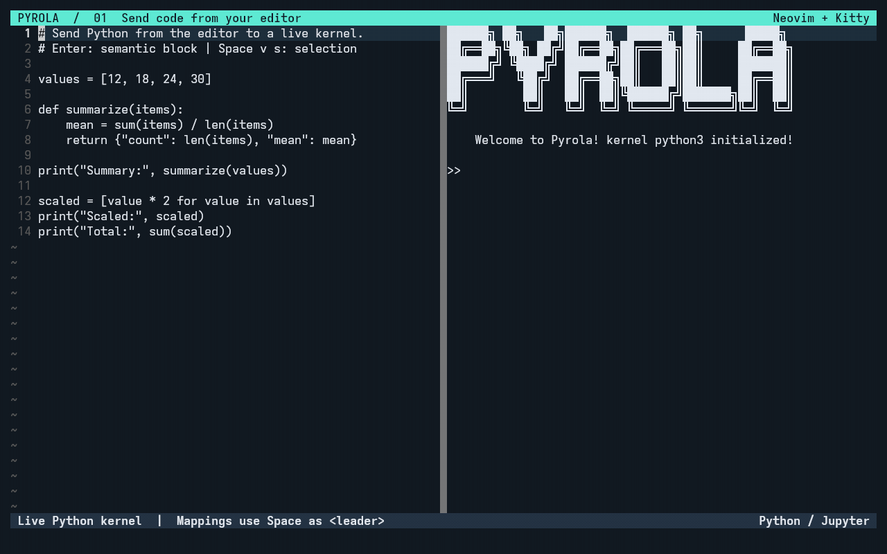
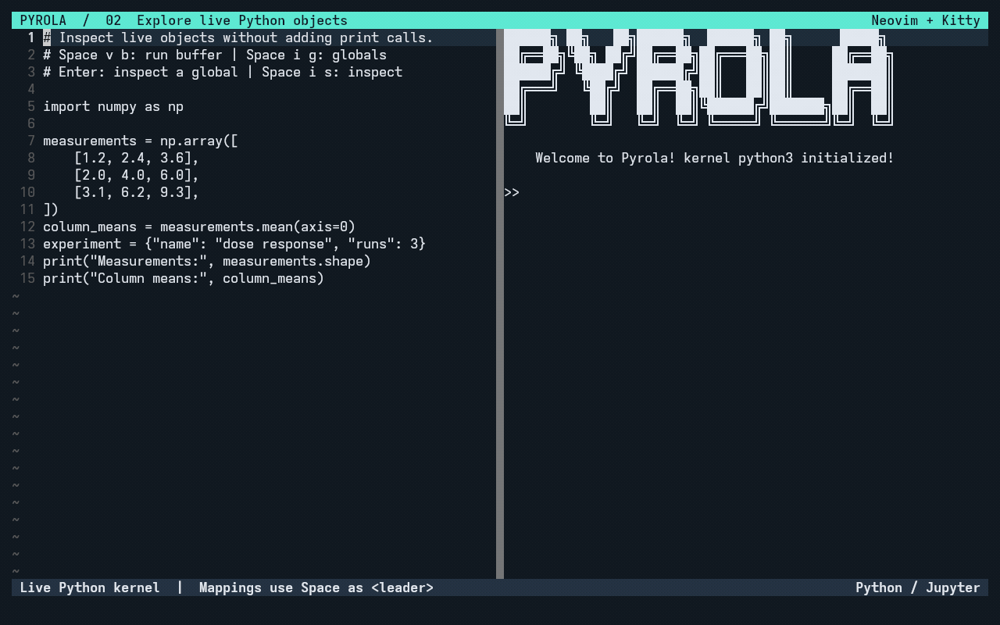
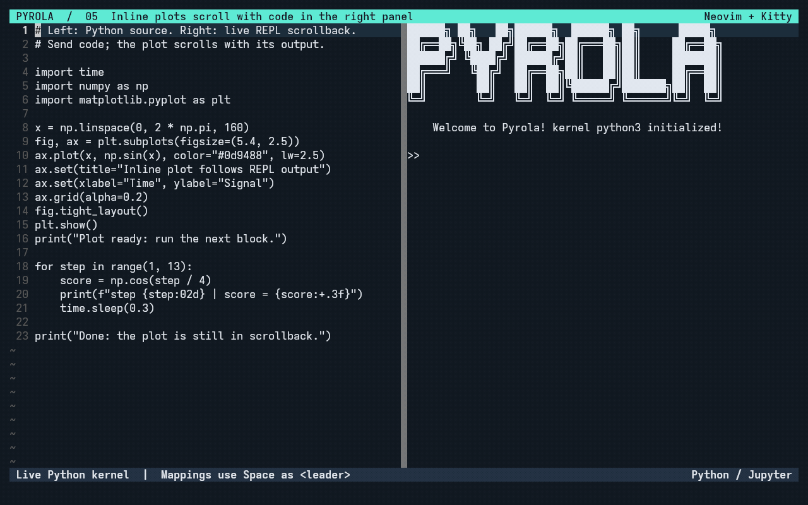
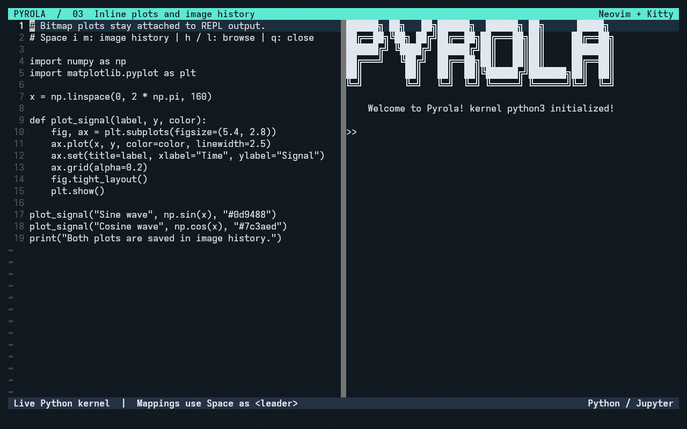
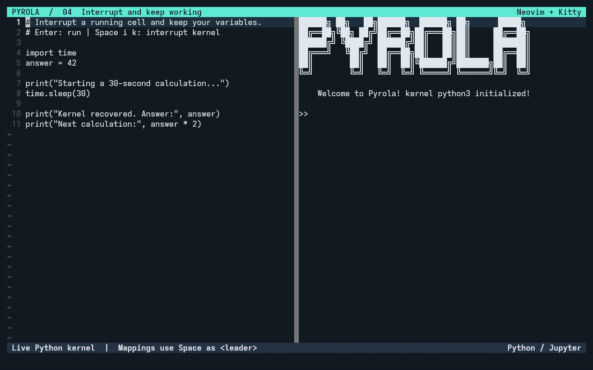

<div align="center">

</div>

---

# Pyrola

If you are seeking an alternative to **Jupyter**, **Spyder**, or **RStudio** in Neovim, **Pyrola** is the solution.

Pyrola delivers a **multi-language REPL (Read-Eval-Print Loop)** experience inside **Neovim**. It is designed for interactive programming, especially for **data scientists**, and supports:

* Real-time code execution
* Variable inspection
* Image visualization

Since Pyrola is built on Jupyter kernels, **any language** with a Jupyter kernel can be integrated.

---

## Demo

### Send statements, functions, and selections

Press `<CR>` to send the Python statement or complete function under the cursor.
Select lines with `V`, then press `<leader>vs` to send just that selection.
These recordings use **Space** as `<leader>`.



### Explore live variables

Run a buffer with `<leader>vb`, open globals with `<leader>ig`, and press `<CR>`
on an entry to inspect its type, shape, and values. Use `<leader>is` to inspect
the symbol under the editor cursor.



### Scroll inline plots with code in the right panel

Send code from the left editor and watch the plot move upward with new commands
and output in the right REPL panel. Scroll back to recover the same plot beside
its original code. In the REPL's Normal mode, `<C-y>` and `<C-e>` scroll one line
at a time.



### Browse image history

Matplotlib plots render inside Kitty's REPL pane and scroll with their output.
Press `<leader>im` for a larger preview, use `h` / `l` to browse previous plots,
and press `q` to return to the editor.



### Interrupt and keep working

Press `<leader>ik` to interrupt a long-running cell. The same kernel stays
available, with its existing variables, for the next calculation.



Recorded from real Neovim, Kitty, and Python/Jupyter sessions.
[Recording instructions](docs/gifs/README.md).

## Features

- **Multi-language support**: Any language with a Jupyter kernel works in Pyrola (Python, R, C++, Julia, etc.).

- **Real-time REPL**: Execute code dynamically within Neovim with immediate feedback.

- **Multiple code-sending methods**: Send code via Tree-sitter semantic blocks, visual selection, or entire buffer.

- **Variable inspector**: Inspect variables (class, type, shape, content) directly from the REPL (Python and R).

- **Global variable browser**: View all user globals in a floating window. Press `<CR>` on any variable to inspect it.

- **Image viewer**: Preview image outputs in a floating window via Kitty or iTerm2 terminal protocols.

- **Image history**: Browse previously plotted images in a floating window.

- **Reliable interrupts**: Interrupt long-running cells and recover cleanly.

- **One-command setup**: `:Pyrola setup` installs dependencies and prepares a managed `pyrola_<language>` kernel automatically.

- **Auto kernel registration**: Pyrola auto-manages `pyrola_python`, `pyrola_r`, `pyrola_cpp`, and `pyrola_julia` unless you explicitly override the kernel name.

---

## Installation

Requires **Neovim 0.11 or newer** and Python 3.10 or newer. Verified locally
against the latest stable Neovim **0.12.6**. Pyrola uses a standalone Python
server; `:UpdateRemotePlugins` and a configured Neovim Python provider are
not required. The console still requires the `pynvim` Python package, which
is included in the requirements and checked by `:Pyrola init`.

### 1. Plugin setup

Add Pyrola to your plugin manager. Example using `lazy.nvim`:

```lua
{
  "matarina/pyrola.nvim",
  dependencies = { "nvim-treesitter/nvim-treesitter" },
  config = function()
    local pyrola = require("pyrola")

    pyrola.setup({
      -- Optional: point to a specific Python (conda/venv).
      -- If omitted, Pyrola uses the active python3 from PATH.
      -- python_path = "~/miniconda3/envs/ds/bin/python",

      -- Optional overrides. When omitted, Pyrola auto-creates and uses
      -- managed kernels named pyrola_<language>.
      kernel_map = {
        -- python = "custom-python-kernel",
        -- r = "custom-r-kernel",
      },
      split_horizontal = false,
      split_ratio = 0.65,
      image = {
        cell_width = 10,
        cell_height = 20,
        max_width_ratio = 0.5,
        max_height_ratio = 0.5,
        offset_row = 0,
        offset_col = 0,
        protocol = "auto", -- auto | kitty | iterm2 | none
        inline = "auto", -- auto | kitty | blocks | none
      },
    })

    -- Keybindings
    vim.keymap.set("n", "<CR>", pyrola.send_statement_definition, { noremap = true })
    vim.keymap.set("v", "<leader>vs", pyrola.send_visual_to_repl, { noremap = true })
    vim.keymap.set("n", "<leader>vb", pyrola.send_buffer_to_repl, { noremap = true })
    vim.keymap.set("n", "<leader>is", pyrola.inspect, { noremap = true })
    vim.keymap.set("n", "<leader>ig", pyrola.show_globals, { noremap = true })
    vim.keymap.set("n", "<leader>ik", pyrola.interrupt_kernel, { noremap = true })
    vim.keymap.set("n", "<leader>im", pyrola.open_history_manager, { noremap = true })
  end,
},

-- Install Tree-sitter parsers for semantic block selection.
-- Without a parser, sending a statement falls back to the current line.
{
  "nvim-treesitter/nvim-treesitter",
  build = ":TSUpdate",
  config = function()
    local ts = require("nvim-treesitter")
    ts.setup({ install_dir = vim.fn.stdpath("data") .. "/site" })
    ts.install({ "python", "r", "lua" })
  end,
}
```

### 2. Python environment setup

Pyrola needs a few Python packages. There are three ways to set them up:

#### Option A: One-command setup (recommended)

Open a file and run:

```vim
:Pyrola setup
```

This installs all dependencies via pip and prepares the managed kernel for the current filetype. By default the managed name is `pyrola_<language>`. When finished, run `:Pyrola init` to start.

#### Option B: Manual install

```bash
pip install -r /path/to/pyrola.nvim/rplugin/python3/requirements.txt
pip install ipykernel
python3 -m ipykernel install --user --name py3
```

If you manually set `kernel_map.python = "py3"`, the kernel name must match that explicit config.

#### Option C: Auto-prompted install

When you run `:Pyrola init` with missing packages, Pyrola prompts you to install them. If the kernel is missing for a Python file, it offers to install and register it.

### 3. Conda / venv users

Usually you do not need extra config. Pyrola follows the active environment that launched Neovim and creates managed kernels named `pyrola_<language>`.

Set `python_path` only if you want to override the active Python interpreter:

```lua
pyrola.setup({
    python_path = "~/miniconda3/envs/ds/bin/python",
})
```

This takes precedence over the active `python3` on PATH.

### 4. Non-Python kernels

Pyrola auto-creates `pyrola_r`, `pyrola_cpp`, and `pyrola_julia` by reusing the language kernel available in the current environment. If the underlying language kernel is missing, install it first:

| Language | Underlying kernel requirement | Managed name |
|----------|------------------------------|--------------|
| **R** | `IRkernel` installed in the active R environment | `pyrola_r` |
| **C++** | `xeus-cling` installed | `pyrola_cpp` |
| **Julia** | `IJulia` installed | `pyrola_julia` |

### 5. Inline plots and image preview

On Neovim 0.12+ in Kitty 0.28+, PNG plots use true bitmap images inline in
the REPL terminal buffer. Colored Unicode placeholders keep each image attached
to its output lines, so it scrolls with the code and stays in terminal scrollback.
The original raster is retained; rendering is not limited to character blocks.
Open the image history manager for a larger floating view.

`image.inline = "auto"` enables this in Kitty and falls back to `timg` character
blocks elsewhere. Use `"kitty"` to explicitly request the bitmap path, `"blocks"`
for the old preview, or `"none"` to disable inline images. The bitmap cache retains
the latest 50 plots; plots older than that may no longer render in scrollback.
Inline output fits the terminal pane when emitted; narrowing the pane later
can reflow older output, as it does other terminal text.

### Floating image viewer

Pyrola renders images in floating windows via **Kitty** or **iTerm2** terminal protocols (`image.protocol = "auto"` detects automatically).

Kitty floats use Unicode image placeholders so the plot stays centered and survives
mouse clicks and editor redraws. Its size and position follow the current editor
rows/columns and `max_width_ratio`/`max_height_ratio`; Kitty preserves aspect ratio
inside that rectangle. Resizing the terminal or changing its font automatically
updates the viewer, without assumed character pixel sizes. Close the image with `q` or `<Esc>` while its
window is focused; moving the cursor no longer dismisses it. Verified interactively
on Linux with Kitty and Neovim 0.12.6.

For the **character-block fallback** in the REPL console output, install [timg](https://github.com/hzeller/timg):

```bash
# Debian/Ubuntu
apt install timg

# macOS
brew install timg
```

**tmux users:** Add to `~/.tmux.conf`:

```tmux
set -g focus-events on
set -g allow-passthrough all
```

---

## Usage

### Commands

| Command | Description |
|---------|-------------|
| `:Pyrola setup` | Install dependencies + prepare the managed kernel for the current filetype |
| `:Pyrola init` | Start kernel and open REPL terminal |

Both commands support tab completion.

### Sending code

| Function | Description |
|----------|-------------|
| `pyrola.send_statement_definition()` | Send the Tree-sitter semantic block under cursor. When REPL is not running, falls back to normal `<CR>`. |
| `pyrola.send_visual_to_repl()` | Send visual selection to REPL. Exits visual mode and moves cursor to next code line. |
| `pyrola.send_buffer_to_repl()` | Send the entire buffer to REPL. |

### Inspecting variables

| Function | Description |
|----------|-------------|
| `pyrola.inspect()` | Inspect the symbol under cursor in a floating window. Uses Tree-sitter to identify the symbol, falls back to `<cword>`. Shows type, shape, content, methods, etc. Supports Python and R. |
| `pyrola.show_globals()` | Show all user variables in a floating window. Press `<CR>` on any entry to inspect it. Press `q` or `<Esc>` to close. |

### Kernel control

| Function | Description |
|----------|-------------|
| `pyrola.interrupt_kernel()` | Send SIGINT to interrupt the running kernel execution. |

### Image history

| Function | Description |
|----------|-------------|
| `pyrola.open_history_manager()` | Open image history browser. Use `h`/`l` to navigate, `q` to close. |
| `pyrola.show_last_image()` | Show the most recent image in a floating window. |
| `pyrola.show_previous_image()` | Navigate to the previous image in history. |
| `pyrola.show_next_image()` | Navigate to the next image in history. |

---

## Configuration reference

```lua
pyrola.setup({
    -- Python interpreter path. Supports ~ expansion.
    -- Priority: python_path > exepath("python3") > g:python3_host_prog > "python3"
    python_path = nil,

    -- Optional explicit overrides. If a filetype is omitted, Pyrola uses
    -- its managed kernel name: pyrola_<language>.
    kernel_map = {
        -- python = "python3",
        -- r = "ir",
        -- cpp = "xcpp17",
    },

    -- REPL terminal split direction and size.
    split_horizontal = false,  -- false = vertical split (right), true = horizontal (bottom)
    split_ratio = 0.65,        -- fraction of editor width/height for the split

    -- Image display settings.
    image = {
        cell_width = 10,        -- terminal cell width in pixels (for size calculations)
        cell_height = 20,       -- terminal cell height in pixels
        max_width_ratio = 0.5,  -- max image width as fraction of editor columns
        max_height_ratio = 0.5, -- max image height as fraction of editor lines
        offset_row = 0,         -- adjust image row position (cells)
        offset_col = 0,         -- adjust image col position (cells)
        protocol = "auto",      -- "auto" | "kitty" | "iterm2" | "none"
    },
})
```

---

## Highlight groups

Floating windows use theme-aware defaults (linked to `FloatBorder`, `FloatTitle`, `NormalFloat`). Highlight groups are automatically refreshed when you change colorscheme. Override them for custom colors:

```lua
-- Inspector window
vim.api.nvim_set_hl(0, "PyrolaInspectorBorder", { link = "FloatBorder" })
vim.api.nvim_set_hl(0, "PyrolaInspectorTitle",  { link = "FloatTitle" })
vim.api.nvim_set_hl(0, "PyrolaInspectorNormal", { link = "NormalFloat" })

-- Image window
vim.api.nvim_set_hl(0, "PyrolaImageBorder", { link = "FloatBorder" })
vim.api.nvim_set_hl(0, "PyrolaImageTitle",  { link = "FloatTitle" })
vim.api.nvim_set_hl(0, "PyrolaImageNormal", { link = "NormalFloat" })

-- Globals window
vim.api.nvim_set_hl(0, "PyrolaGlobalsBorder", { link = "FloatBorder" })
vim.api.nvim_set_hl(0, "PyrolaGlobalsTitle",  { link = "FloatTitle" })
vim.api.nvim_set_hl(0, "PyrolaGlobalsNormal", { link = "NormalFloat" })
```

---

## Troubleshooting

### `:Pyrola init` says "No such kernel"

If you set an explicit `kernel_map` override, that name must exist:

```bash
jupyter kernelspec list
```

For Python, register a matching kernel:

```bash
python3 -m ipykernel install --user --name py3
```

If you do not want to manage kernels manually, remove the explicit override and run `:Pyrola setup`.

### `:Pyrola init` says "python3 executable not found"

Set `python_path` in your config or ensure `python3` is on PATH:

```lua
pyrola.setup({ python_path = "/usr/bin/python3" })
```

### Non-Python managed kernel setup fails

Pyrola can create `pyrola_r`, `pyrola_cpp`, and `pyrola_julia`, but the underlying language kernel must already be installed in the active environment:

- R: install `IRkernel`
- C++: install `xeus-cling`
- Julia: install `IJulia`

### Images don't display

1. Check your terminal supports Kitty or iTerm2 image protocols.
2. For inline REPL images, install `timg`: `apt install timg` or `brew install timg`.
3. In tmux, ensure `allow-passthrough all` and `focus-events on` are set.

### REPL is unresponsive

Use `pyrola.interrupt_kernel()` to send SIGINT. If the kernel is fully hung, restart with `:Pyrola init`.

### `:Pyrola init` says "request timed out"

Kernel startup can take longer on the first launch, especially in slower or remote environments. Pyrola now waits up to 30 seconds for `:Pyrola init`.

If it still times out, verify the configured Python can import the required packages and start the target kernel:

```bash
python3 -c "import jupyter_client, pynvim, prompt_toolkit, PIL, pygments"
jupyter kernelspec list
```

---

## TODO

- [ ] **Multi-language variable inspector**: Extend inspection beyond Python and R.

## Credits

* [Jupyter Team](https://github.com/jupyter/jupyter)
* [nvim-python-repl](https://github.com/geg2102/nvim-python-repl) — Pyrola draws inspiration from this project.

## Local demo

With the Python dependencies installed in the system Python, run
`./examples/run-demo.sh` to open the Linux metrics example in Kitty.
The demo config installs the README mappings locally in Python/R/C++/Julia
source buffers, including normal-mode **Enter** to send a semantic statement.
The REPL keeps its own Enter behavior. Python block selection needs the
Python Tree-sitter parser; install it with your parser manager.

## Verification

Run the integration suite in an isolated virtual environment:

```bash
python3 -m venv .venv
.venv/bin/python -m pip install -r rplugin/python3/requirements.txt ipykernel
./tests/run.sh
```

Set `PYROLA_TEST_PYTHON` to use another Python environment. The runner isolates
Jupyter kernelspecs and Neovim's XDG directories in a temporary directory.
It tests real kernel startup, terminal execution, Tree-sitter statement
selection, variable inspection, globals, interrupts, repeated initialization,
terminal shutdown, and RPC crash/restart/timeout handling. Pixel image output
still needs a manual check in a Kitty- or iTerm2-compatible terminal; headless
runs only verify safe image-module loading.

## Contributing

Contributions are welcome! Issues and pull requests will receive prompt attention.

**Note:** Terminal graphic protocols such as **Sixel** are not yet supported inside Neovim terminal buffers due to upstream limitations (see [Neovim Issue #30889](https://github.com/neovim/neovim/issues/30889)).
